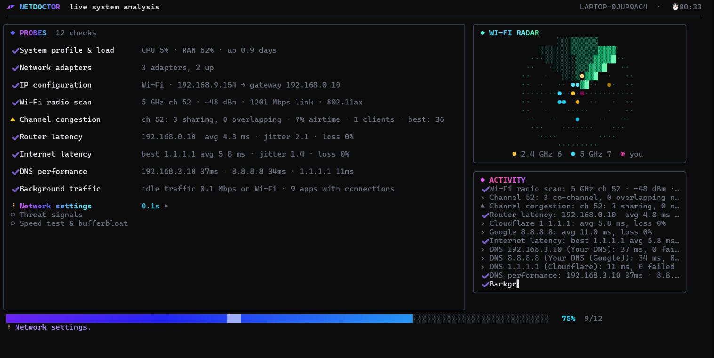
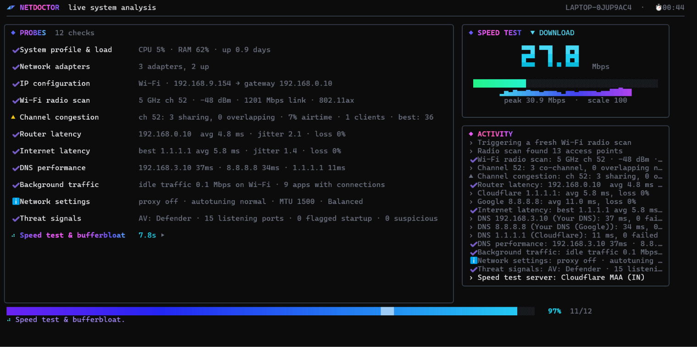
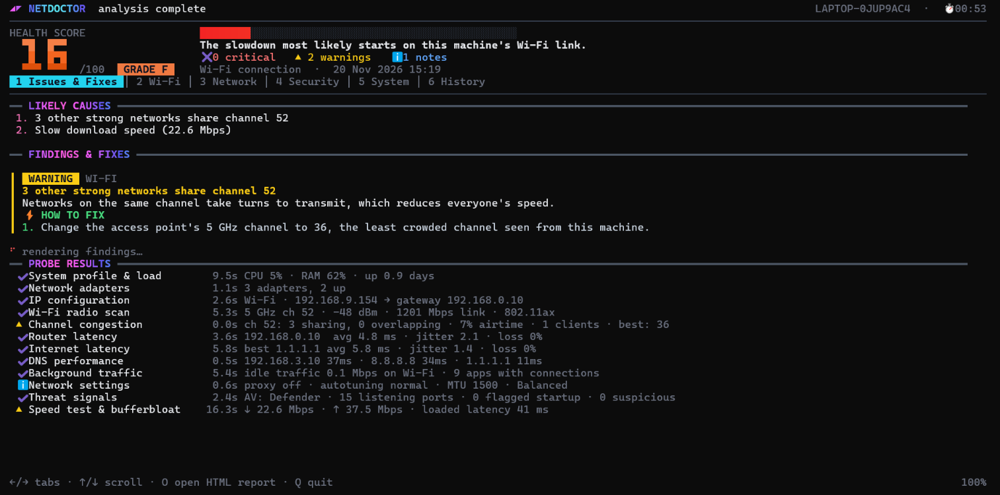

# NetDoctor


A single-file Windows tool that finds out why a machine's internet is slow and checks for basic threat signals. It shows an animated terminal interface and writes a JSON and an HTML report.

## Screenshots

**1. Start-up:** the splash screen wakes the Wi-Fi radio before the scan begins.


**2. Live scan:** each probe runs in turn, with a Wi-Fi radar of nearby access points and an activity log.



**3. Speed test:** multi-stream download and upload, with latency under load (bufferbloat).



**4. Results:** health score, likely causes, findings with step-by-step fixes, and every probe result. Tabs cover Wi-Fi, network, security, system and history.



## Run it

Build `netdoctor.exe` (see [Build from source](#build-from-source)), copy it to the machine and run it from Windows Terminal. Running as administrator gives the most complete results.

```powershell
.\netdoctor.exe                 # full scan with animated interface
.\netdoctor.exe --no-speedtest  # skip the speed test (saves 100-300 MB of data)
.\netdoctor.exe --plain         # no animations, for remote shells or logs
.\netdoctor.exe --out D:\reports
```

Reports are saved in `netdoctor-reports` next to the program.

In the results screen: arrow keys or 1-6 switch tabs, up and down scroll, `O` opens the HTML report, `Q` quits.

## Compare one machine on different networks and access points

The sweep moves this machine's Wi-Fi to each access point of the current network in turn, runs the network tests on each, then reconnects to the original network. It also reconnects if you press Ctrl+C.

```powershell
.\netdoctor.exe sweep                  # every access point of the current network in range
.\netdoctor.exe sweep --networks       # also your other saved Wi-Fi networks in range
.\netdoctor.exe sweep --no-speedtest   # faster, uses much less data
```

It shows the test plan and asks before it starts. Other options: `--min-signal 30` skips weaker access points, `--max 8` limits how many are tested, and `--yes` skips the question.

To compare places the sweep cannot reach, such as another floor, home or Ethernet, run a normal scan there with a name:

```powershell
.\netdoctor.exe --label "2nd floor desk"
.\netdoctor.exe --label "Ethernet"
```

The History tab in the results screen lists this machine's saved runs side by side and names the best connection. `compare` also works on runs from one machine, and labels the columns by network and access point.

## Find out why only some machines are slow

Run NetDoctor on a slow machine and on a fast one, collect the JSON files, then:

```powershell
.\netdoctor.exe compare reports\*.json
```

The table highlights the worst value of each metric in red and lists the differences that stand out.

## What it checks

| Area | Checks |
|---|---|
| Wi-Fi | Fresh radio scan, band, channel, signal, link rate, Wi-Fi standard, encryption, sticky roaming, driver age, adapter settings such as preferred band |
| Channels | Co-channel and overlapping networks, access point airtime and client count, best 2.4 and 5 GHz channel from this spot, whether your network is missing from the access point's 5 GHz radio |
| Latency | Router and internet ping with loss and jitter, to tell local problems from ISP problems |
| DNS | Configured DNS servers against Cloudflare and Google |
| Speed | Multi-stream download and upload, plus latency under load (bufferbloat) |
| Adapters | Ethernet stuck at 100 or 10 Mbps, half duplex, active VPNs, multiple gateways |
| Settings | Proxy, TCP auto-tuning, MTU, power plan, Wi-Fi power saving, hosts file |
| Bandwidth | Idle background traffic, apps with the most connections, torrent and sync tools |
| Security | Defender and firewall state, programs in user folders talking to the internet, risky open ports, suspicious startup entries, hosts file hijacks |
| System | CPU and memory load, top processes, uptime |

## Build from source

Needs Go 1.27 or later.

```powershell
git clone https://github.com/varunvasudevan/netdoctor.git
cd netdoctor
```

```powershell
go build -trimpath -ldflags="-s -w" -o netdoctor.exe .
```

## Notes

- Windows 11 24H2 and later need location permission for Wi-Fi details: Settings › Privacy & security › Location, then allow desktop apps.
- Text parsing of `netsh` output assumes an English Windows display language.
- The security checks flag warning signs. They do not replace an antivirus scan.

## Contributing

Issues and pull requests are welcome. Please don't attach real reports to issues: they contain hostnames, IP and MAC addresses and Wi-Fi names.

## Author

**Varun Kumar** · [GitHub](https://github.com/varunvasudevan) · [Portfolio](https://varunvasudevan.github.io)

## License

[MIT](LICENSE)
